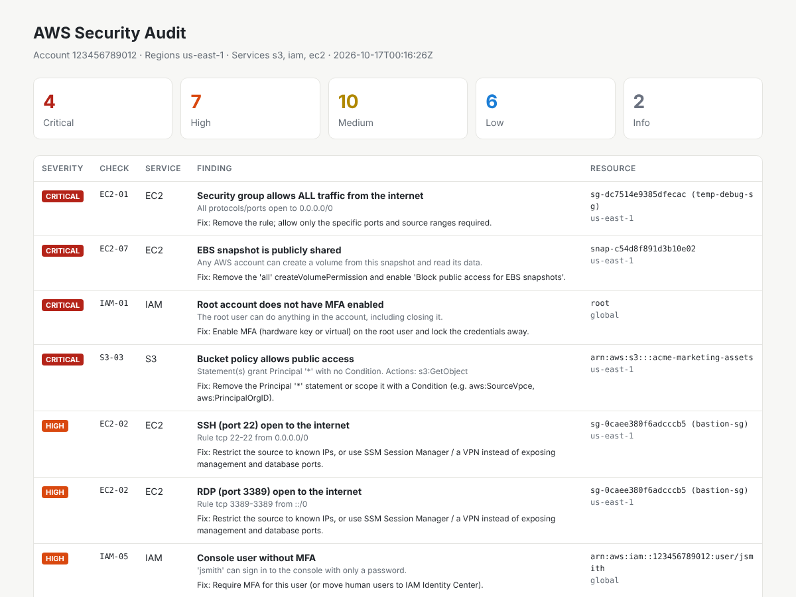
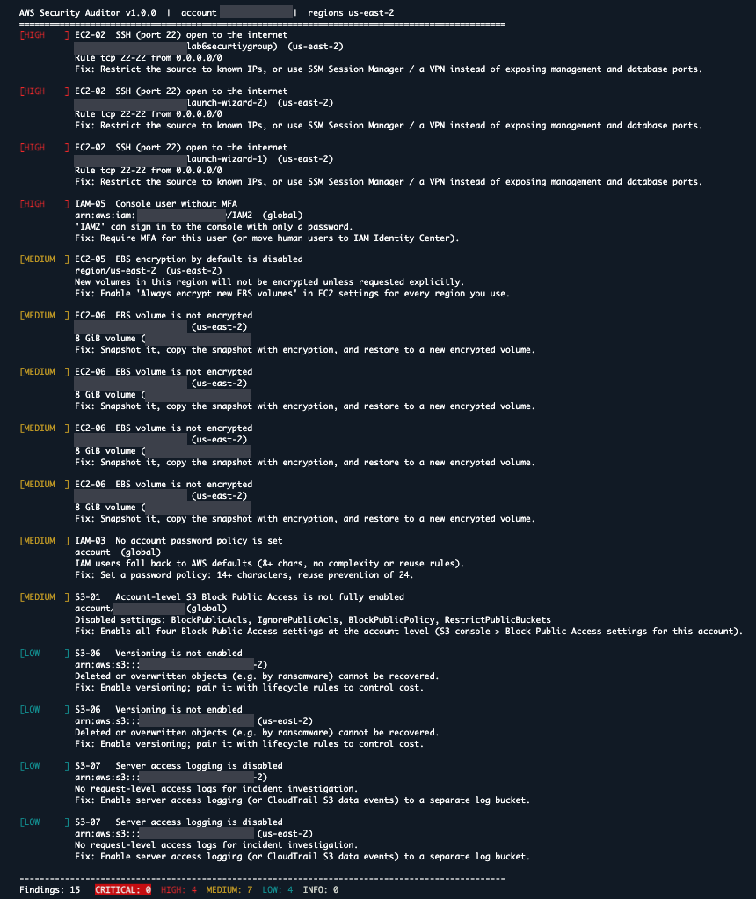

# AWS Security Auditor

A read-only Python/boto3 CLI that scans an AWS account for common, high-impact misconfigurations in **S3, IAM and EC2**, ranks them by severity, and writes console, JSON and HTML reports with a remediation step for every finding.



## Why

Most cloud breaches aren't zero-days — they're a public bucket, an open SSH port, or an admin access key nobody rotated. This tool checks for exactly those, using only `Describe*` / `Get*` / `List*` calls, so it is safe to run against any account you can read.

## Checks (24)

| ID | Service | Severity | What it detects |
|---|---|---|---|
| S3-01 | S3 | Medium | Account-level Block Public Access not fully enabled |
| S3-02 | S3 | Medium | Bucket-level Block Public Access not fully enabled |
| S3-03 | S3 | Critical | Bucket policy grants `Principal: "*"` with no `Condition` |
| S3-04 | S3 | High / Critical | ACL grants AllUsers or AuthenticatedUsers (Critical if write) |
| S3-05 | S3 | Medium | No default encryption configuration |
| S3-06 | S3 | Low | Versioning disabled (no ransomware recovery) |
| S3-07 | S3 | Low | Server access logging disabled |
| IAM-01 | IAM | Critical | Root user has no MFA |
| IAM-02 | IAM | Critical | Root user has access keys |
| IAM-03 | IAM | Medium | No account password policy |
| IAM-04 | IAM | Low | Password policy < 14 chars or reuse prevention < 24 |
| IAM-05 | IAM | High | Console user without MFA |
| IAM-06 | IAM | Medium | Active access key older than 90 days |
| IAM-07 | IAM | Medium | Active access key unused for 90+ days |
| IAM-08 | IAM | High | `AdministratorAccess` attached directly to a user |
| IAM-09 | IAM | High | Inline user policy allows `*` on `*` |
| IAM-10 | IAM | High | Attached customer-managed policy allows `*` on `*` |
| EC2-01 | EC2 | Critical | Security group allows all traffic from `0.0.0.0/0` or `::/0` |
| EC2-02 | EC2 | High | SSH, RDP, Telnet or a database port open to the internet (incl. port ranges) |
| EC2-03 | EC2 | Medium | Instance allows IMDSv1 (SSRF credential-theft risk) |
| EC2-04 | EC2 | Info | Instance has a public IP |
| EC2-05 | EC2 | Medium | EBS encryption-by-default disabled in region |
| EC2-06 | EC2 | Medium | Unencrypted EBS volume |
| EC2-07 | EC2 | Critical | EBS snapshot shared publicly |

## Real-world test

I ran the auditor against my own AWS lab account from AWS CloudShell (October 2026). It returned **15 findings: 0 critical, 4 high, 7 medium, 4 low**.

- **High:** three security groups allowed SSH (port 22) from `0.0.0.0/0`, including two `launch-wizard` groups that the EC2 console creates by default, and one IAM console user had no MFA.
- **Medium:** EBS encryption by default was off, four EBS volumes were unencrypted, no account password policy was set, and account-level S3 Block Public Access was not fully enabled.
- **Low:** two S3 buckets had versioning and server access logging disabled.

Account IDs, resource IDs and bucket names are redacted.



## Quick start

```bash
git clone https://github.com/asheriff15/aws-security-auditor.git
cd aws-security-auditor
python -m venv .venv && source .venv/bin/activate      # Windows: .venv\Scripts\activate
pip install -r requirements-dev.txt

# No AWS account needed: scan a simulated, deliberately misconfigured account
python -m auditor --demo
```

### Scan a real account

```bash
aws configure --profile audit          # or: aws sso login --profile audit
python -m auditor --profile audit --region us-east-1
python -m auditor --profile audit --all-regions --min-severity MEDIUM
python -m auditor --profile audit --services iam,s3 --fail-on HIGH   # exit code 2 if HIGH+ found
```

Reports land in `./reports/` as `audit-<account>-<timestamp>.json` and `.html`.

| Flag | Purpose |
|---|---|
| `--profile` | AWS CLI profile (otherwise the default credential chain) |
| `--region` (repeatable) / `--all-regions` | Regions to scan for EC2 (S3 and IAM are global) |
| `--services` | Subset of `s3,iam,ec2` |
| `--min-severity` | Hide findings below a level |
| `--fail-on` | Non-zero exit for CI/CD gating |
| `--no-files` | Console output only |
| `--demo` | Run against a moto-simulated account |

## Permissions

The tool never writes to your account. Attach either the AWS-managed **`SecurityAudit`** policy, or the least-privilege policy in [`iam-policy.json`](iam-policy.json), which lists exactly the API calls the scanner makes. If a permission is missing, that check is skipped and listed under "skipped calls" rather than crashing the scan.

## Design

```
auditor/
├── cli.py          argument parsing, auth, orchestration, exit codes
├── models.py       Severity enum, Finding dataclass, CheckContext (client cache + error guard)
├── policy.py       IAM/resource-policy parsing (admin wildcards, public principals)
├── report.py       console / JSON / HTML output
├── demo.py         seeds a vulnerable account in moto for --demo
└── checks/
    ├── s3.py  iam.py  ec2.py   one module per service; each exposes run(ctx)
```

- **Adding a check** = write a function that calls `ctx.add(...)`, call it from that module's `run()`. Adding a service = new module + one line in `checks/__init__.py`.
- **Fail soft:** every API call runs inside `ctx.guard()`, which records `AccessDenied` and keeps scanning — real audit roles are often partially scoped.
- **Adaptive retries** via botocore config, and paginators everywhere, so it works on accounts with thousands of resources.
- **Tested without AWS:** 23 pytest cases run against [moto](https://github.com/getmoto/moto), each asserting a misconfiguration *is* flagged and the secure equivalent is *not* (false-positive checks matter as much as detection).

## Tests

```bash
pytest -q
```

CI runs the suite on every push via GitHub Actions (`.github/workflows/tests.yml`).

## Roadmap

- CloudTrail (multi-region trail, log file validation), GuardDuty enabled, VPC flow logs
- IAM credential report for faster scanning of large user bases
- Map findings to CIS AWS Foundations Benchmark control IDs
- SARIF output for GitHub code scanning

## Disclaimer

Only scan accounts you own or are authorized to assess.
